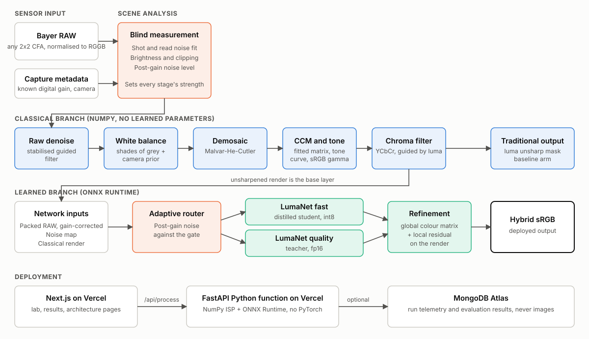

# LumaForge

**A hybrid learned smartphone ISP: classical camera stages plus a compact neural restorer.**

Team Asphalt (T32) · Problem P2: Intelligent and Computationally Efficient Smartphone ISP

> **Status: work in progress.** The source code is in place. Model training has not finished, so
> this repository does not yet contain trained models, evaluation results, the
> `eval_P2_T32.md` file, the design document or a live URL. No performance numbers are claimed
> until they are generated from the held-out test set.



## What it does

LumaForge turns noisy Bayer RAW into sRGB in three comparable ways:

| Arm | Method |
|---|---|
| Traditional | Classical ISP in pure NumPy, calibrated on the training scenes |
| Learned | Compact U-Net mapping packed RAW directly to sRGB |
| Hybrid | The classical render is the base layer. The network predicts a global colour correction and a local residual |

The adaptive pipeline measures noise from the mosaic itself, sets each stage's strength, and
routes each capture to a fast int8 model or a larger fp16 model.

## Classical stages

- Bayer normalisation to RGGB, and Malvar-He-Cutler demosaicing
- White balance: shades of grey with a per-camera prior
- Colour correction matrix fitted per camera
- Variance-stabilised guided filtering, plus chroma filtering in YCbCr
- Tone curve and sRGB gamma
- Luma-only sharpening

## Data

- **Training and testing:** [SIDD-CC](https://huggingface.co/datasets/MhdMohammadi/SIDD-CC), a
  public re-processing of the [Smartphone Image Denoising Dataset](https://abdokamel.github.io/sidd/).
  The official SIDD server was unreachable during this work.
- **Architecture reference:** [Modular Neural ISP](https://github.com/SamsungLabs/modular_neural_isp)
  (Samsung Labs). That repository contains code and no image data.

Dataset files are not stored in this repository.

## Repository layout

```text
lumaforge/   ISP stages, network, degradations, metrics, ONNX runtime
api/         FastAPI function for Vercel, optional MongoDB storage
app/         Next.js pages
components/  Interactive lab, results and telemetry views
scripts/     Data preparation, calibration, training, export, evaluation, reporting
tests/       Unit and API tests
```

## Run locally

```bash
python -m venv .venv
.venv/Scripts/activate        # on Linux or macOS: source .venv/bin/activate
pip install torch torchvision --index-url https://download.pytorch.org/whl/cpu
pip install -r requirements-train.txt
pytest -q

npm install
npm run build
```

The API needs exported models in `models/`, which are produced after training.

## Team

| USN |
|---|
| 1RUA24CSE0100 |
| 1RUA24CSE0109 |
| 1RUA24CSE0111 |
| 1RUA24CSE0114 |
| 1RUA24CSE0098 |
